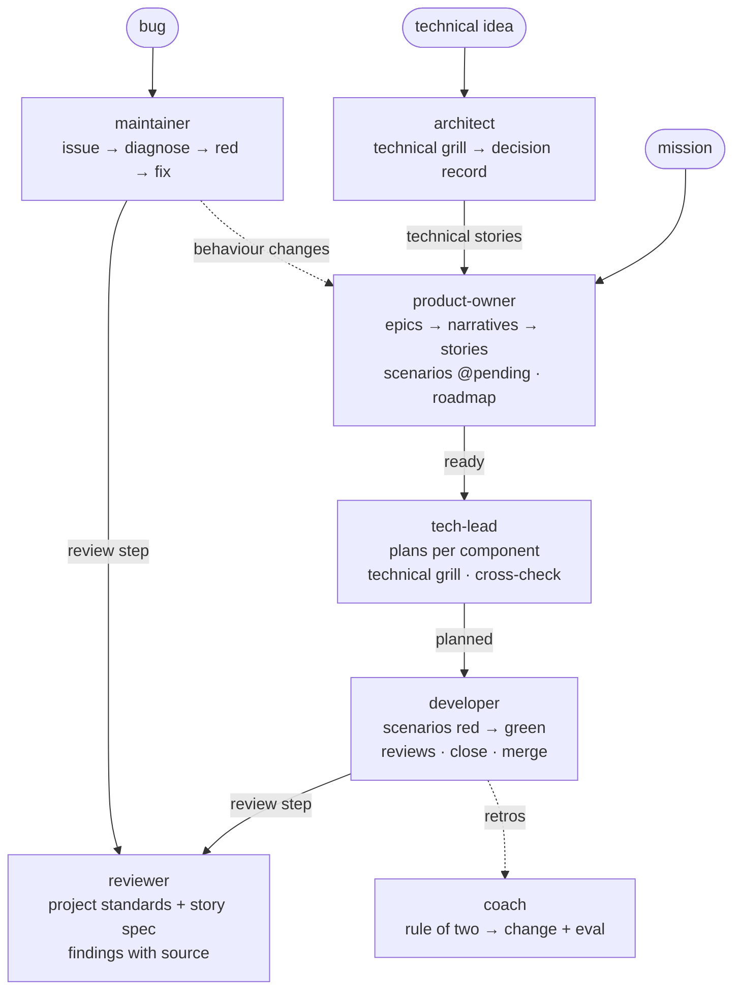

<p align="center">
  
</p>

<h1 align="center">sanchin</h1>

<p align="center"><b>A reproducible, spec-first development process for Claude Code.</b><br>
Executable specs · validated artifacts · deterministic gates · progressive context.</p>◊

<p align="center">
  <a href="LICENSE"></a>
  
  
</p>

---

sanchin is a Claude Code plugin that runs one development process, the same
way on every story, in every project. A product owner grills the mission
into epics, narratives and stories with you and places them in a roadmap; a
tech-lead designs each story, one plan per component; a developer makes its
scenarios red, then green, through two reviews and a retro that feeds the
process itself; an architect turns technical ideas into decision records. A
validator and deterministic gates check every hand-off, so the process holds
whether or not the agent remembers it.

It grew inside a real multi-service project. Everything specific to that
project went into an **adapter**; what is left is the process.

```text
/plugin marketplace add anthropics/claude-plugins-official   # for its dependency
/plugin marketplace add rai22474/sanchin
/plugin install sanchin@sanchin
/sanchin:init
```

### Where to start

| If you want to… | Read |
|---|---|
| Try it now | [Quickstart](#quickstart) |
| Understand the process | [docs/process.md](docs/process.md), then [docs/artifacts.md](docs/artifacts.md) |
| Configure a project | [docs/adapter.md](docs/adapter.md) |
| Bring it into an existing repo | [docs/adopting.md](docs/adopting.md) |
| See everything | [docs/index.md](docs/index.md) · [Documentation](#documentation) |

## Contents

- [Quickstart](#quickstart)
- [How it works](#how-it-works)
  - [The four pillars](#the-four-pillars)
  - [The process](#the-process)
  - [Roles](#roles)
- [Configuration](#configuration)
- [Validator and gates](#validator-and-gates)
- [How it compares](#how-it-compares)
- [Design decisions](#design-decisions)
- [Documentation](#documentation)
- [Contributing](#contributing)
- [Why "sanchin"](#why-sanchin)
- [License](#license)

## Quickstart

### Requirements

- [Claude Code](https://claude.com/claude-code) with plugin support.
- `git`.
- [`uv`](https://docs.astral.sh/uv/) (recommended) or a `python3` with
  PyYAML and `gherkin-official`, for the validator.

Installing sanchin also installs its one dependency,
[mattpocock-skills](https://github.com/mattpocock/skills), whose grilling
and code-review skills run the grills and the first review. It comes from
the official marketplace, `claude-plugins-official`, which must be added:
without it sanchin installs but **does not load** (`/plugin` shows
"failed to load").

### 1. Install

```text
/plugin marketplace add anthropics/claude-plugins-official   # skip if already added
/plugin marketplace add rai22474/sanchin
/plugin install sanchin@sanchin
```

### 2. Initialize the project

```text
/sanchin:init
```

`init` looks at what the repository already has — stories, feature files,
plans, decision records, standards, git hooks, CI — and writes
`.claude/sanchin.yaml` with the project's own names and paths. In a new
repository it creates the minimum: base documents (grilled with you),
templates and indexes. **Nothing is moved or renamed.** Re-run it any time
as a doctor.

### 3. Approve the gates

```bash
scripts/sanchin trust
```

Gates are shell commands, so the hook runs them only after you approve the
list — and again whenever it changes ([gates.md](docs/gates.md#trust)).

### 4. Build something

```text
/sanchin:product-owner     # mission → epics → narratives → stories → roadmap
/sanchin:tech-lead         # a ready story → its plans
/sanchin:developer         # a planned story → merged code
```

Each role runs its cycle of [the process](#the-process) and stops for you.
Check the project at any time — locally, in a git hook, or in CI:

```bash
scripts/sanchin check        # inside Claude Code: ${CLAUDE_PLUGIN_ROOT}/scripts/sanchin
```

### Sharing with your team

Add the plugin to the project's `.claude/settings.json` so everyone working
on it gets the same process — both marketplaces, since the dependency comes
from the official one:

```json
{
  "extraKnownMarketplaces": {
    "sanchin": {"source": {"source": "github", "repo": "rai22474/sanchin"}},
    "claude-plugins-official": {"source": {"source": "github", "repo": "anthropics/claude-plugins-official"}}
  },
  "enabledPlugins": {"sanchin@sanchin": true}
}
```

**Prefer this to a user-wide install:** projects that
don't use sanchin then never see its skills or its hook. (The role skills
only take over in a project with an adapter, but a user-wide install still
offers them everywhere.) To bring sanchin into a repository that already has
its own process, see [docs/adopting.md](docs/adopting.md).

## How it works

### The four pillars

1. **Executable specs.** Every acceptance criterion has a scenario that
   cites it and that fails for the right reason before the code exists.
   Feature files, organized by capability, are the living description of the
   system — not a prose spec someone has to keep true by hand.
2. **Validated artifacts.** Stories, plans, scenario deltas, doubt markers
   and constitution checklists are checked by a validator, not by goodwill.
3. **Deterministic gates.** What can be checked by code is checked by code,
   at the earliest level where it is cheap — from the moment Claude saves a
   file to CI.
4. **Progressive context.** Thin entry points and indexes that say *what*
   each document holds and *when* to read it, so an agent loads the ten
   documents its task needs instead of all two hundred.

And one principle that ties them together: **specs are immutable and
incremental.** An implemented story is never edited; a change is a new
story with a *supersedes* line and a scenario delta (+ / ~ / −), and the
current behaviour is whatever the scenarios — kept true by the tests — say.

### The process



Four cycles, one role each; a role finishes, leaves its artifacts
validated, and stops. A story's state says whose turn it is: **pending** →
**ready** (product owner) → **planned** (tech-lead) → **in progress** →
**implemented** (developer).

Each step carries a *why* in [docs/process.md](docs/process.md) — the general
reason behind it, never the anecdote that produced it, so it applies to
cases nobody has seen yet.

### Roles

| Skill | Role |
|---|---|
| `/sanchin:init` | Maps an existing project into the adapter (or scaffolds a new one), creates only what's missing, proposes gates. Re-run it as a doctor. |
| `/sanchin:product-owner` | Grills the mission into epics, narratives and stories, writes their scenarios, places them in the roadmap's milestones, hands them over ready. Also: what to build next. |
| `/sanchin:tech-lead` | Takes a ready story to planned: one plan per component, technical grill, cross-check. |
| `/sanchin:developer` | Takes a planned story to merged code: scenarios red, green, reviews, close, merge. |
| `/sanchin:architect` | Turns a technical idea — a refactor, a new tool — into a decision record and technical stories. Also: whether an approach fits. |
| `/sanchin:maintainer` | Fixes a bug through the short lane, or escalates it to the product owner as a story. |
| `/sanchin:reviewer` | Reviews against the project's standards and the story's spec, without repeating the gates or a generic review. |
| `/sanchin:coach` | Reads the retros, finds what keeps recurring, proposes process changes with their eval. |

None of them holds principles of its own: they read the project's mission
and vision, stack, constitution and glossary, wherever the adapter says
they are.

## Configuration

The adapter, `.claude/sanchin.yaml`, is the only project-specific file:

```yaml
version: 1
language: en
components: [app, api]
stories:   {directory: docs/stories, glob: 'st-*.md', rules_since: '2026-11-01'}
scenarios: {globs: ['{component}/tests/features/**/*.feature']}
plans:     {directory: docs/plans, rules_since: '2026-11-01'}
gates:
  - {name: ruff, glob: '*.py', run: 'uv run ruff check {file}', level: edit}
```

`init` writes it for you; every field is documented in
[docs/adapter.md](docs/adapter.md).

## Validator and gates

```bash
scripts/sanchin check                    # every rule
scripts/sanchin check --only docs        # docs | stories | plans (repeatable)
scripts/sanchin superseded [--write]     # print / rewrite the superseded-by table
scripts/sanchin gates --level pre-push FILE…   # run the project's gates of one level
scripts/sanchin trust                    # approve the adapter's gates for the hook
```

Exit code `0` means clean, `1` rule violations, `2` a missing or invalid
adapter. The same check runs on every edit (plugin hook), in git hooks and
in CI — see [docs/validator.md](docs/validator.md) for the rules and a
pinned CI step, and [docs/gates.md](docs/gates.md) for the four gate levels.

## How it compares

sanchin borrows from [Spec Kit](https://github.com/github/spec-kit) and
[OpenSpec](https://github.com/Fission-AI/OpenSpec), and parts ways where
experience on a real project pointed elsewhere.

| Idea | Spec Kit | OpenSpec | sanchin |
|---|---|---|---|
| Where the current spec lives | Spec documents | `openspec/specs/`, prose merged from deltas on archive | **Executable feature files**; no prose spec to keep true |
| Changing behaviour | New spec | Delta (ADDED / MODIFIED / REMOVED) merged into the spec | New immutable story with *supersedes* + scenario delta, checked against the feature files |
| Ambiguity | `[NEEDS CLARIFICATION]`, `/clarify` | `/opsx:explore` | Doubt markers, answered in a functional grill, **blocked by the validator** |
| Principles | Constitution + plan gates | Free-form `context` in `config.yaml` | Constitution checklist in every plan, exceptions tied to decisions; mission, vision, stack and glossary as separate documents |
| Consistency across artifacts | `/analyze` | `/opsx:verify` | Cross-check before code, and a spec review after it |
| Verification | Checklists | `validate` | Validator + four gate levels + scenarios red before green |
| Context for the agent | Templates | Project context | Progressive disclosure: indexes with *what* and *when*, checked |
| Improving the process | Extensions, presets | Schemas | Retro per story, rule of two, **eval-tested skills**, a coach |
| Bugs | Bug extension | — | Short lane with an escalation rule |

What sanchin deliberately does **not** take: a hand-maintained living spec
(the scenarios are it), an archive of change folders (stories and plans
already record each change), and a fixed folder layout (the adapter maps
whatever the project has).

## Design decisions

sanchin records its own decisions the way it asks projects to. Full records
in [docs/decisions/](docs/decisions/index.md).

<details>
<summary>All 18 decisions, with their one-line why</summary>

| | Decision | Why |
|---|---|---|
| [0001](docs/decisions/0001-plugin-and-adapter.md) | A plugin for the process, one adapter per project | A copied template can't receive improvements; a pinned plugin can. |
| [0002](docs/decisions/0002-executable-scenarios.md) | Executable scenarios are the living spec | A spec the tests run can't silently become false. |
| [0003](docs/decisions/0003-immutable-incremental-stories.md) | Stories are immutable and incremental | History is added to, never rewritten. |
| [0004](docs/decisions/0004-story-core-optional-layers.md) | Story at the core; epics, narratives, milestones optional | Ceremony for small projects, discipline for large ones. |
| [0005](docs/decisions/0005-story-order.md) | Functional grill first, red once, cross-check before code | Each check where it is cheapest. |
| [0006](docs/decisions/0006-plans-worktrees-merge.md) | One plan per component, one worktree per story, local merge (or a pull request) | A contract written twice diverges; shared working trees mix commits. |
| [0007](docs/decisions/0007-validator.md) | Built-in validator rules, configurable values | Same guarantees everywhere, no checker to rewrite. |
| [0008](docs/decisions/0008-deterministic-gates.md) | Gates at four levels; broken twice → a gate | A rule in a prompt is enforced only as well as the prompt is read. |
| [0009](docs/decisions/0009-progressive-context.md) | Progressive context: format, not layout | Adoption shouldn't be a migration. |
| [0010](docs/decisions/0010-doubt-markers.md) | Doubts are marked, and block the story | An agent asked to fill a gap invents something plausible. |
| [0011](docs/decisions/0011-constitution-checklist.md) | Plans answer the constitution as a checklist | Records that every rule was looked at. |
| [0012](docs/decisions/0012-two-reviews-measured.md) | Two reviews, measured by source | Whether the second earns its cost is a question for data. |
| [0013](docs/decisions/0013-bug-lane.md) | A short lane for bugs, with escalation | Most bugs don't need two grills; the ones that do are stories in disguise. |
| [0014](docs/decisions/0014-role-skills-without-principles.md) | Role skills without principles of their own | Copied principles go stale and argue against the project. |
| [0015](docs/decisions/0015-continuous-improvement.md) | Retro per story, rule of two, eval-driven skill changes | Skills drift like code unless tested like code. |
| [0016](docs/decisions/0016-general-whys.md) | Every rule carries a general why | Anecdotes are matched by shape; reasons generalize. |
| [0017](docs/decisions/0017-english.md) | sanchin in English, projects in their own language | Widest common language for the plugin; each team keeps its words. |
| [0018](docs/decisions/0018-depend-on-mattpocock-skills.md) | Depend on mattpocock-skills for grills and the generic review | A step that runs only if a plugin happens to be installed isn't reproducible. |
| [0019](docs/decisions/0019-roles-per-cycle.md) | Four cycles, one role each, five story states | Each hand-off is a decision with an owner; the state says whose turn it is. |
| [0020](docs/decisions/0020-short-increments-smart-stories.md) | Short increments, SMART stories | Every check — grill, scenario, review, context — works on a small change and degrades on a big one. |

</details>

## Documentation

The full index lives in [docs/index.md](docs/index.md). New to sanchin?
Read [process.md](docs/process.md) → [artifacts.md](docs/artifacts.md) →
[adapter.md](docs/adapter.md) → [adopting.md](docs/adopting.md), in that order.

| Document | For |
|---|---|
| [process.md](docs/process.md) | The loop, the bug lane, pacing, git and approvals — what the skills follow. |
| [artifacts.md](docs/artifacts.md) | Base documents, stories, scenarios, plans, layers, issues — format and rules. |
| [adapter.md](docs/adapter.md) | Every field of `.claude/sanchin.yaml`. |
| [validator.md](docs/validator.md) | Validator commands, rules, hooks and CI. |
| [gates.md](docs/gates.md) | The four gate levels and how to declare a project's gates. |
| [context.md](docs/context.md) | Progressive disclosure: entry points, indexes, navigation. |
| [improvement.md](docs/improvement.md) | Retros, the rule of two, evals, the coach, releases. |
| [adopting.md](docs/adopting.md) | Bringing sanchin into an existing project. |
| [decisions/](docs/decisions/index.md) | sanchin's own decision records. |
| [templates/](templates/index.md) · [evals/](evals/README.md) | Starting points, and the skills' own tests. |

## Contributing

sanchin runs its own process on itself: its docs are checked by its own
validator ([.claude/sanchin.yaml](.claude/sanchin.yaml)), and a skill
change starts with an eval that fails today
([improvement.md](docs/improvement.md)).

```bash
# Validator unit tests
PYTHONPATH=scripts:tests uv run --no-project --with pyyaml --with gherkin-official==42.0.1 python3 -m unittest discover -s tests

# The repo's own docs
scripts/sanchin check

# Skill evals, with a no-plugin baseline (needs a sandbox; see evals/README.md)
evals/run.sh --scaffold --allow-tools Bash Write Edit
```

Notable changes go in [CHANGELOG.md](CHANGELOG.md). Versions follow
semantic versioning; a change to the adapter format is a major version.

## Why "sanchin"

*Sanchin* (三戦, "three battles") is the foundational kata of Naha-te and
Gōjū-ryū: the form a karateka repeats for life, the same way every time,
until it is second nature. This plugin is that idea applied to building
software with an agent — one process, repeated the same way on every story,
in every project, and improved a little after each one.

## License

[MIT](LICENSE)
