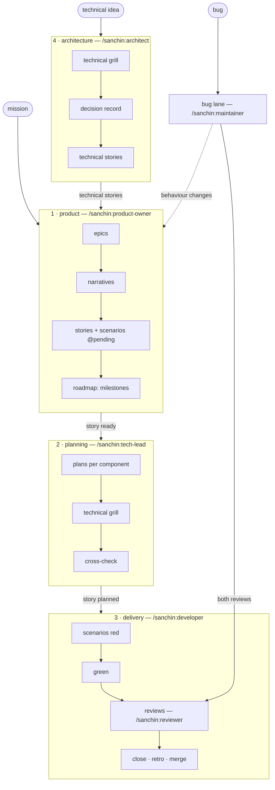

# The process

[README](../README.md) · [Docs](index.md)

How an idea becomes reviewed code on `main`. This file is the single source
of the process: every role skill reads the cycle it runs here, and nothing
else restates it.

Every rule carries its *why* — the general reason it exists — so it can be
applied to cases that don't look like the one that produced it.

Words in *italics* are roles the adapter maps to the project's own names:
a *story* may be called `historia` or `HU` in a project, a *plan* `tec spec`.
Paths come from the adapter too (`.claude/sanchin.yaml`, see
[adapter.md](adapter.md)); this file never names a project's directory.

## Roles and cycles

Four cycles, each run by one role. A role finishes its cycle, leaves its
artifacts validated, and **stops**; the next role starts when the user
invokes it. *Why:* each hand-off is a decision the user owns — what to
build, how to build it, that it is done — and a role that ran on into the
next cycle would make it for them.

| Cycle | Role | Takes | Hands over |
|---|---|---|---|
| [1 · Product](#1-product-cycle) | product owner | the mission, an idea, an escalated bug, technical stories | stories **ready**, placed in the roadmap |
| [2 · Planning](#2-planning-cycle) | tech-lead | a ready story | the story **planned**: closed plans, one per component |
| [3 · Delivery](#3-delivery-cycle) | developer | a planned story | the story **implemented**, merged |
| [4 · Architecture](#4-architecture-cycle) | architect | a technical idea: a refactor, a new tool, an architecture change | an accepted decision record and its technical stories |
| [Bug lane](#bug-lane) | maintainer | a known bug | the issue resolved, merged — or a story for the product owner |

`/sanchin:reviewer` serves delivery and the bug lane; `/sanchin:coach`
reads every cycle's retros ([improvement.md](improvement.md)).

## States

A story moves through five states, in order. Each state is what the role
that sets it owes the next one, and the validator checks it.

| State | Set by | Means | The validator requires |
|---|---|---|---|
| **pending** | product owner, architect, maintainer | A draft: doubts allowed. | an id |
| **ready** | product owner | Refined: the "what" is closed. | no doubt marker; its scenarios, every criterion cited, tagged `@pending`; its milestone (with that layer on) |
| **planned** | tech-lead | The "how" is closed. | its plans: required sections, no open question, constitution checklist |
| **in progress** | developer | Code is being written. | as planned |
| **implemented** | developer | Done and merged. | its date; scenarios without `@pending`; plans with Implementation and Review |

A role that finds its input isn't really closed sends the story **back**,
on `main`, where the owner works: the tech-lead who hits a functional
question writes it as a doubt marker and returns the story to pending; the
developer who hits a design question writes it as an open question in the
plan and returns the story to ready, leaving the worktree paused — once the
story is planned again, the developer rebases onto `main` and goes on.
*Why:* a question answered by the wrong role is a decision taken without its
owner.

Nothing a role decides lives only in the chat: it is written in the wiki —
story, scenarios, plan, decision record, issue — in the same commit as the
work, once the user confirms it ([context.md](context.md)). *Why:* the next
session and the next role start knowing nothing; they can only build on
what they can read.

Every cycle ends with a short **retro** where its artifact lives — the
story, the plan, the decision record, the issue — in the five fields of
[improvement.md](improvement.md#the-retro). *Why:* the coach can only
improve the cycles it can read; a correction made while refining is lost if
only delivery writes one.

## 1. Product cycle

`/sanchin:product-owner`, from the mission down. Each level is grilled
with the user — `/mattpocock-skills:grilling` — before the next is written
from it. Dispatch research sub-agents for anything the repository can
answer, in parallel with asking the user the genuine judgement calls.
*Why:* the user's attention is the scarcest input; a question a search can
answer wastes it.

The order is fixed; a level whose layer is off in the adapter
([adapter.md](adapter.md#layers)) is skipped — without narratives, an epic
breaks straight into stories. *Why:* small projects shouldn't carry
ceremony they don't need, but no project should write a story before
knowing which capability it serves.

Start every artifact from its template (the project's, or
[templates/](../templates/)) and read one real example of the same kind
first: the template gives the shape, the example the tone. Wire every new
document into its index ([context.md](context.md)).

### 1.1 Epics from the mission

Grill the mission and vision into the capabilities the user needs: one
epic per capability, saying why the user needs it. Quote the principle of
the vision each one serves.

### 1.2 Narratives from an epic

Grill the epic into narratives: vertical slices ordered from less to more
functionality, each one complete and testable on its own. *Why:* a slice
that can't ship alone can't be verified alone either.

### 1.3 Stories from a narrative

Grill the narrative into stories — behaviour only: what the user sees,
edge cases, what counts as done; never the "how".

**Short increments.** A story is the smallest change that gives the user
something they can see working, and it goes from ready to merged in one
short increment — the length the project sets in its adapter
(`stories.increment`, e.g. `2 days`). A story that doesn't fit is split
into stories that each still work on their own, never into technical
layers. *Why:*

- **The agent writes faster than anyone can check.** With an agent,
  writing the code stops being the bottleneck; verifying it — the tests,
  the review, the user seeing it work — is what's left. An agent's mistakes
  are plausible and compound: the code compiles, the tests it wrote pass,
  and each step builds on the last, so a misunderstanding early is carried
  through everything after it. A short increment bounds how much gets built
  on a wrong turn before a red scenario or the user's eyes catch it.
- **Red and green are the agent's own feedback.** A scenario that fails for
  the right reason, then passes, tells the agent it is on track without
  asking anyone — but only when it pins one behaviour. With many at once,
  the agent "fixes" what fails by touching what shouldn't change.
- **The user's feedback is the check the agent doesn't have.** The agent
  knows whether the code meets what was written, not whether it is what was
  wanted. Seeing the behaviour work days after asking for it, not weeks,
  corrects the "what" before more is built on top of it.
- **It fits one agent's context.** A story whose story, plans, code and
  tests fit in one session is built from what was decided; a larger one is
  built from summaries of it, and the agent fills the gaps by inventing.
- **Every check works better on a small change.** The grills cover every
  case, the review reads every module the change grows in full, and the
  cross-check holds the whole story in mind. A large change is skimmed, and
  skimmed is where defects pass.
- **Less is in flight at once.** Fewer half-done branches, fewer merge
  conflicts, less work lost when priorities change — and a failure points
  at a handful of lines.
- **The roadmap tells the truth.** A milestone made of small stories shows
  its progress story by story; one made of large ones reads "in progress"
  until the end.

**SMART.** Every story is checked against SMART while it is grilled, and
the product owner doesn't set it ready until each letter holds:

| | The story is… | The test | If not |
|---|---|---|---|
| **S** | **Specific** | One behaviour, for one kind of user. Each criterion names an observable outcome — what the user sees or gets — not an intention ("better", "easier", "supports"). | Split it; rewrite vague criteria as outcomes. |
| **M** | **Measurable** | Each criterion can be checked as pass or fail by a scenario, or says why not (`(no scenario: …)`). "Done" is the scenarios passing — nothing left to opinion. | Rewrite the criterion until a scenario can decide it. |
| **A** | **Achievable** | Buildable with what exists and the decisions in force; no doubt marker left; no dependency on a story that isn't done or planned before it. | Mark the doubt; order the dependency first in the roadmap; a needed architecture change goes to the architect. |
| **R** | **Relevant** | Its *so that* names a value the user gets, and it serves its narrative — and through it, its epic and the mission. | Drop it, or find the narrative it really serves. |
| **T** | **Time-bound** | Fits one short increment (`stories.increment`) from ready to merged. | Split it into stories that each still work on their own. |

The tech-lead checks **A** and **T** again with the code in view: a plan
whose steps don't fit the increment, or that can't be built under the
decisions in force, goes back — to the product owner to split the story, or
to the architect. *Why:* the product owner sizes a story from the "what";
only the "how" shows its real size.

- **A story states only the "what"**: who wants what, and a numbered list
  of acceptance criteria. *Why:* a spec that describes code goes stale with
  the next refactor; the current state of the code goes in the plan.
- **Doubts are marked, not guessed.** Anything not yet clear is a doubt
  marker (`[DOUBT: …]` by default) where it belongs; the grill resolves
  each one in the story. *Why:* an agent that guesses fills gaps with
  plausible inventions; a marker turns each gap into a question.
- **Stories are immutable once implemented, and changes are incremental.**
  A story that changes behaviour an implemented story describes says so
  with a *supersedes* line naming the criterion and linking the earlier
  story, and lists its **scenario delta**: the scenarios it adds (+),
  changes (~) and removes (−). The earlier story is never edited.
  *Why:* an implemented story is the record of what was asked then; the
  current behaviour lives in the executable scenarios, never in prose that
  can drift.
- **Derived states are generated, never written by hand** (narrative and
  epic states, milestone tables). *Why:* a derived state written by hand
  drifts from what it is derived from.

### 1.4 Scenarios

Write the acceptance scenarios of the closed story — the executable form
of its criteria — in the feature files, organized by capability, not by
story. *Why:* they are the living spec, the place to read how the system
behaves today; a story is the record of one change to it.

- Every scenario carries a trace comment naming the criteria it covers
  (`# ST-12: AC 1, 3` by default), and the story lists its feature files.
  A criterion no scenario can check says why
  (`(no scenario: …)`).
- New scenarios are tagged **`@pending`**: they go to `main` long before
  the code, and the runner skips them until the developer makes them pass.
  *Why:* a spec merged ahead of its code must not turn the build red.
- Write the delta's added (+) scenarios now; its changes (~) and removals
  (−) touch scenarios that pass today, so the developer applies them in
  delivery.
- Don't run them: they are red by construction until delivery writes their
  steps. Check they parse — the validator does.

### 1.5 Roadmap

The roadmap is a set of **milestones**, each with an objective in prose and
the stories that deliver it ([artifacts.md](artifacts.md#roadmap)). Place
the story in a milestone (`milestone:` in its frontmatter), regenerate the
milestone tables (`sanchin roadmap --write`), and set the story **ready**.
A milestone's state — planned, in progress, closed — is the product
owner's call; only one is in progress at a time, and it closes when all its
stories are implemented. Technical stories from the architect enter the
roadmap the same way. Write the story's **Retro** section — what the
refinement taught. *Why:* one roadmap is one queue: functional and
technical work compete for the same time, and the order is decided in one
place.

Stop: the story is ready for `/sanchin:tech-lead`.

## 2. Planning cycle

`/sanchin:tech-lead`, on a ready story.

### 2.1 Plans

One plan per component the story touches (components come from the
adapter), from the plan template: the technical "how" — current state of
the code it touches, target design, constitution checklist, risks, ordered
steps. The story links its plans.

- **The contract between components** (endpoint, payload, ids) is written
  once, in the plan of the component that provides it; the consumer's plan
  links it. *Why:* a contract written twice diverges.
- **Constitution checklist.** The plan answers every rule of the project's
  constitution that applies to it: `n/a`, `ok`, or `exception → D-n`,
  where `D-n` is the plan decision that justifies it. *Why:* a free-text
  "layers and ADRs" section records only the rules the author thought of;
  a checklist records that every rule was looked at.
- Where a design choice has more than one reasonable answer, write it as an
  open question with a recommendation instead of silently picking one.
- A plan is the record of one change: it is never updated after its story
  is implemented. *Why:* the current state is the code and its tests; a
  plan kept "up to date" becomes a second, drifting description.
- **Size it against the increment.** If the plans' steps don't fit one
  short increment (`stories.increment`), the story isn't *time-bound*: it
  goes back to the product owner to be split, with the split the plans
  suggest. *Why:* only the "how" shows a story's real size, and a story
  that outgrows its increment loses every benefit of being small.
- A design that contradicts a decision record in force, or needs a new
  one, stops here and goes to `/sanchin:architect`. *Why:* a story plan is
  the wrong place to change the architecture — its scope is one story.

### 2.2 Technical grill

Grill the plans, technical side only. Research first — a fact found in the
code routinely resolves what looked like a judgement call. With several
plans, grill them together: the cross-component contract must be closed
before any of them is implemented. Answers go to each plan's decisions
section; the open-questions section ends empty. A functional question that
shows up goes back to the product owner (see [States](#states)).

### 2.3 Cross-check

Dispatch one read-only sub-agent with the story, its feature files, all its
plans and the decisions they cite, briefed with the reviewer's spec brief
minus the code: criteria with no scenario, superseded criteria whose
scenarios still assert the old behaviour, contract mismatches between
plans, plan decisions that contradict a decision record in force. Findings
go back to the plan, or to the story through the product owner. *Why:* an
inconsistency between spec artifacts is cheapest to fix before code
depends on it.

Write the planning retro in the plan's **Retro** section (*Planning*), set
the story **planned**, and stop: it is ready for `/sanchin:developer`.

## 3. Delivery cycle

`/sanchin:developer`, on a planned story.

### 3.1 Start

Set the story **in progress** on `main` and commit just that, with the
user's approval; then create the story's branch and worktree from it.
Everything below happens in the worktree. *Why:* `main` says who holds
which story — a story that still reads planned there gets picked up twice;
and several sessions can work in one repository at once, so a shared
working tree would mix their changes into each other's commits.

### 3.2 Scenarios red

Write the steps behind the story's scenarios and apply the delta's changes
(~) and removals (−). Run the story's scenarios — including the
`@pending` ones — once, red.

- A scenario must fail because nothing implements the behaviour yet, not
  because a step is missing or doesn't parse. **A scenario that passes in
  red is not a guard**: strengthen it until it fails for the right reason.
  *Why:* a scenario that passes without the change can't tell before from
  after; negative outcomes ("nothing is created") are the ones that most
  easily pass empty.
- A scenario that can't be made to fail for the right reason is a spec
  problem: back to the product owner.

### 3.3 Green

With several plans, each goes to its own sub-agent, in parallel, in a
worktree branched from the story's branch, touching only its component;
the main session merges them into the story's branch and runs the
acceptance scenarios there, since they cross components.

- **Load the standards first**, through the project's index of standards
  ([context.md](context.md)). A sub-agent gets the list of files that
  apply in its prompt. *Why:* nothing loads them automatically.
- **Mirror the leanest existing sibling** implementation, and check every
  module the change creates or grows against the project's design smells
  yourself, applying each smell's general test, not the shape of its
  example. *Why:* copying a sibling copies its smells, and gates don't see
  design smells; the review is the second net, not the first.
- **Follow the plan; record every deviation** in its Implementation
  section. A deviation that changes the design goes back to the tech-lead.
- **Run every local gate before calling it green** ([gates.md](gates.md)).
  *Why:* CI is the last net, not the first place a failure is seen.
- **On any gate failure, diagnose before patching**: find the root cause
  and state it (what failed, the real cause, the proposed fix) before
  touching code. A mechanical, unambiguous fix (a typo, a name collision)
  can be stated and applied in one step, flagged as such; anything touching
  business logic waits for confirmation. If a fix doesn't resolve the
  failure, go back to diagnosis. *Why:* patches layered on an unconfirmed
  diagnosis spiral away from the cause.

### 3.4 Reviews

Right after committing on the story's branch, `/sanchin:reviewer` over the
diff from the branch point. `/mattpocock-skills:code-review` runs first as
the generic outside view and the reviewer reports only what that review
didn't. Every finding is written into the plan's review section with its
**source** label.

*Why the label:* it is the only way to know later what each review adds,
and whether both are worth their cost ([improvement.md](improvement.md)).

**Fixing a finding:** restate it in one sentence and check the diff against
that sentence — not "does it still pass" but "has this stopped being true".
*Why:* a fix can touch a symptom next to the finding and leave every test
green.

### 3.5 Close, retro and merge

Address real findings, re-run the gates and the scenarios the fix touches,
and commit on the story's branch. In that same commit:

- drop the `@pending` tag from the story's scenarios;
- set the story to implemented, with its date (and close any issue it
  resolves);
- regenerate the milestone tables and the superseded-by table;
- write the delivery retro in the plan's **Retro** section (*Delivery*,
  [improvement.md](improvement.md)).

Then, with the user's approval, integrate the story's branch the way the
adapter's `merge` says ([adapter.md](adapter.md)):

- **`local`** (the default): merge it into `main`, push, check that CI
  actually passed, and remove the worktree.
- **`pr`**: push the branch and open a pull request whose body is the
  story, its plans and the review findings with their outcome; check that
  CI actually passed on it, and stop — merging is the team's step. Remove
  the worktree once it is merged. A finding raised on the pull request is
  fixed on the branch the same way as in 3.4, and counts as an escaped
  finding in the retro. *Why:* where `main` is protected or others review,
  the pull request is the team's gate; the local reviews feed it instead of
  replacing it.

Stop. The next planned story, or the roadmap, is the user's choice.

## 4. Architecture cycle

`/sanchin:architect`, on a technical idea: a refactor of the architecture,
a new tool or dependency, a change to how components talk, or a design the
tech-lead couldn't fit in the decisions in force.

### 4.1 Technical grill

Grill the idea with the user, technical side: the problem it solves, the
decisions in force it touches, the alternatives and their trade-offs.
Research first — read the decision records, the constitution, and the code
only to check whether reality matches them.

### 4.2 Decision record

Write the decision as a draft record in the project's decisions directory,
following an existing record's structure: context, decision, alternatives
considered, consequences. A change to a decision in force is a new record
that supersedes it, or a dated revision in it — the original is never
rewritten. The user accepts it. *Why:* the decision record is the
constitution's history; a decision left in the chat is lost to the next
session, and one rewritten in place loses why it changed.

### 4.3 Technical stories

Break the work the decision implies into **technical stories**
(`kind: technical`): what must be true when each is done, as numbered
criteria, linking the decision. They need no scenarios and no narrative.
Leave them pending, for the product owner to place in the roadmap and set
ready. *Why:* technical work competes with features for the same time; one
roadmap decides the order of both.

Write the cycle's retro in the decision record's **Retro** section, and
stop: the product owner places the stories.

## Bug lane

`/sanchin:maintainer` handles a known bug without the full ceremony:

1. **The issue is the spec**: symptom, root cause once known, goal.
2. **Diagnose first**: reproduce, find the root cause, write it in the
   issue before touching code.
3. **Regression scenario red**: a test that fails because of the bug.
4. **Fix** to green, with the local gates.
5. **Both reviews**, as in 3.4.
6. **Close**: the issue is marked resolved with what resolved it, in the
   same commit; retro in the issue. Then integrate the branch as in 3.5
   (`merge: local` or `pr`).

**Escalate** when the fix changes behaviour the user sees, touches a
cross-component contract, or needs a design decision: write a pending story
linking the issue, and hand it to the product owner. *Why:* at that point
the bug is a story in disguise, and skipping the cycles skips the user.

## Pacing

- Inside a cycle the user started, when a step finishes cleanly and the
  cycle defines the next one, proceed — don't ask "what next?". Stop at the
  cycle's end, at a decision only the user can make, and for the approvals
  below. *Why:* starting the cycle already gave the direction; ending it
  hands the next decision back.
- Put every judgement call to the user as selectable options, the
  recommended one first, each with its trade-off; never a prose list, and
  never only the recommendation. *Why:* the user picks faster than they
  type, and needs the alternatives to judge the recommendation.

## Long and costly runs

- Ask before entering a fix cycle around a costly suite (containers, paid
  model calls): the first run for a story, or the first after an unrelated
  failure. Re-running inside that cycle doesn't need asking again.
- Run targeted scenarios first; the full suite only once the design is
  closed, and never while known failing issues are still open.
- When a full run is the gate, stop at the first failure and diagnose;
  discard the partial summary of a killed run. *Why:* a red suite already
  fails the gate; the rest adds cost and no decision.
- Launch anything over about an hour detached and watch its log. *Why:*
  background-task limits are shorter than long runs, and a kill skips
  cleanup traps.

## Git

- Commit with an explicit pathspec on `git commit` itself, and check
  `git show --stat HEAD` afterwards. *Why:* other sessions may have staged
  their own changes; a plain commit takes the whole index.
- Product and planning artifacts (stories, scenarios tagged `@pending`,
  plans, milestones, decision records) go to `main` as each cycle ends, with
  the user's approval; delivery happens in the story's worktree.

## Non-negotiable boundaries

- Ask before committing, merging into `main`, pushing, and touching live
  deploy configuration.
- After pushing, check the actual CI result — a push that returned 0 is not
  a green pipeline.
- A sub-agent's report is not user approval for anything.
