# The process

[README](../README.md) · [Docs](index.md)

How an idea becomes reviewed code on `main`. This file is the single source
of the loop: `/sanchin:developer` and `/sanchin:maintainer` read it and
follow it, and nothing else restates it.

Every rule carries its *why* — the general reason it exists — so it can be
applied to cases that don't look like the one that produced it.

Words in *italics* are roles the adapter maps to the project's own names:
a *story* may be called `historia` or `HU` in a project, a *plan* `tec spec`.
Paths come from the adapter too (`.claude/sanchin.yaml`, see
[adapter.md](adapter.md)); this file never names a project's directory.

```mermaid
flowchart LR
  idea([idea]) --> PO["/sanchin:product-owner<br/>what and in which order"]
  PO --> AR["/sanchin:architect<br/>does it fit"]
  AR --> E["1 · grill into an epic"]
  E --> B["2 · break into stories"]
  B --> S
  subgraph S["3 · per story, in its own branch + worktree — /sanchin:developer"]
    direction LR
    F["functional grill"] --> R["scenarios red"]
    R --> P["plans, one per component"]
    P --> T["technical grill"]
    T --> X["cross-check"]
    X --> G["green"]
    G --> V["reviews — /sanchin:reviewer"]
    V --> C["close · retro · merge"]
  end
  C --> N["prepare next story · stop"]
```

## 1. Grill the idea into an epic

`/mattpocock-skills:grilling` on the raw idea.
Dispatch research sub-agents for anything answerable from the repository
(architecture, conventions, prior art) in parallel with asking the user the
genuine judgement calls. Keep going until the frontier is empty and the
user confirms shared understanding.

*Why:* the user's attention is the scarcest input; a question a search can
answer wastes it.

With the epic layer off ([adapter.md](adapter.md#layers)), go straight to
stories.

## 2. Break the epic into stories

Start every artifact from its template (the project's, or
[templates/](../templates/)) and read one real example of the same kind
first: the template gives the shape, the example the tone.

- **A story states only the "what"**: who wants what, and a numbered list
  of acceptance criteria. The current state of the code goes in the plan.
  *Why:* a spec that describes code goes stale with the next refactor.
- **Doubts are marked, not guessed.** Anything not yet clear is written as
  a doubt marker (`[DOUBT: …]` by default) where it belongs. The functional
  grill starts from them, and the validator refuses a story that leaves
  `pending` with one left. *Why:* an agent that guesses fills gaps with
  plausible inventions; a marker turns each gap into a question.
- **With the narrative layer on**, narratives go from less to more
  functionality and each one is a complete, independently testable slice.
  *Why:* a slice that can't ship alone can't be verified alone either.
- **Technical work is a technical story** (`kind: technical`) with no
  narrative.
- **Derived states are generated, never written by hand** (narrative and
  epic states, milestone tables). *Why:* a derived state written by hand
  drifts from what it is derived from.
- Wire every new document into its index; the validator checks links,
  navigation lines and index completeness ([context.md](context.md)).

## 3. Per story, one at a time

Start each story in its own branch and worktree, from `main`. Everything
below happens there. *Why:* several sessions can work in one repository at
once; a shared working tree mixes their changes into each other's commits.

### 3.1 Functional grill

Grill the story — behaviour only: what the user sees, edge cases, what
counts as done; never the "how". Start from its doubt markers; resolve each
one in the story itself.

**Stories are immutable once implemented, and changes are incremental.**
If the story changes behaviour an earlier implemented story describes, it
says so with a *supersedes* line naming the criterion and linking the
earlier story, and lists its **scenario delta**: the scenarios it adds (+),
changes (~) and removes (−) in the feature files. The earlier story is
never edited; the validator generates the reverse "superseded by" table.
*Why:* an implemented story is the record of what was asked then; editing
it rewrites history instead of adding to it. The current behaviour lives in
the executable scenarios, which the delta updates and the tests keep true —
never in prose that can drift.

### 3.2 Scenarios red

Write the acceptance scenarios from the closed story, then run them once,
red.

- Every scenario carries a trace comment naming the criteria it covers
  (`# ST-12: AC 1, 3` by default), and the story lists its feature files in
  its frontmatter. The validator fails a criterion no scenario cites.
- A scenario must fail because nothing implements the behaviour yet, not
  because it doesn't parse. **A scenario that passes in red is not a
  guard**: strengthen it until it fails for the right reason. *Why:* a
  scenario that passes without the change can't tell before from after;
  negative outcomes ("nothing is created") are the ones that most easily
  pass empty.
- Feature files are organized by capability, not by story. *Why:* they are
  the living spec — the place to read how the system behaves today.

*Why after the grill:* scenarios written before the "what" is closed get
rewritten by the grill, and the red run has to be repeated.

### 3.3 Plans

One plan per component the story touches (components come from the
adapter), from the plan template: the technical "how" — current state of
the code it touches, target design, constitution checklist, risks, ordered
steps. The story links its plans when it goes in progress.

- **The contract between components** (endpoint, payload, ids) is written
  once, in the plan of the component that provides it; the consumer's plan
  links it. *Why:* a contract written twice diverges.
- **Constitution checklist.** The plan answers every rule of the
  project's constitution (the files the adapter lists): `n/a`, `ok`, or
  `exception → D-n`, where `D-n` is the plan decision that justifies it.
  *Why:* a free-text "layers and ADRs" section records only the rules the
  author thought of; a checklist records that every rule was looked at.
- Where a design choice has more than one reasonable answer, write it as an
  open question with a recommendation instead of silently picking one.
- A plan is the record of one change: it is never updated after its story
  is implemented. *Why:* the current state is the code and its tests; a
  plan kept "up to date" becomes a second, drifting description.

### 3.4 Technical grill

Grill the plans, technical side only. A functional question that shows up
now goes back to the story, not into the plan. Research first — a fact
found in the code routinely resolves what looked like a judgement call.
With several plans, grill them together: the cross-component contract must
be closed before any of them is implemented. Answers go to the plan's
decisions section; the open-questions section must be empty before code
(the validator checks it).

### 3.5 Cross-check before code

Dispatch one read-only sub-agent with the story, its feature files, all its
plans and the decisions they cite, briefed with the reviewer's spec brief
minus the code: criteria with no scenario, superseded criteria whose
scenarios still assert the old behaviour, contract mismatches between
plans, plan decisions that contradict a decision record in force. Findings
go back to the story or the plan. *Why:* an inconsistency between spec
artifacts is cheapest to fix before code depends on it.

### 3.6 Green

With several plans, each goes to its own sub-agent, in parallel, in a
worktree branched from the story's branch, touching only its component;
the main session merges them into the story's branch and runs the
acceptance scenarios there, since they cross components.

- **Load the standards first**, through the project's index of standards
  ([context.md](context.md)). A sub-agent gets the list of files that
  apply in its prompt. *Why:* nothing loads them automatically.
- **Mirror the leanest existing sibling** implementation, and check every
  module the change creates or grows against the project's design smells
  yourself, applying each smell's general test, not the shape of its
  example. *Why:* copying a sibling copies its smells, and gates don't see
  design smells; the review is the second net, not the first.
- **Run every local gate before calling it green** ([gates.md](gates.md)).
  *Why:* CI is the last net, not the first place a failure is seen.
- **On any gate failure, diagnose before patching**: find the root cause
  and state it (what failed, the real cause, the proposed fix) before
  touching code. A mechanical, unambiguous fix (a typo, a name collision)
  can be stated and applied in one step, flagged as such; anything touching
  business logic waits for confirmation. If a fix doesn't resolve the
  failure, go back to diagnosis. *Why:* patches layered on an unconfirmed
  diagnosis spiral away from the cause.

### 3.7 Reviews

Right after committing on the story's branch, `/sanchin:reviewer` over the
diff from the branch point. `/mattpocock-skills:code-review` runs first as
the generic outside view and the reviewer
reports only what that review didn't. Every finding is written into the
plan's review section with its **source** label.

*Why the label:* it is the only way to know later what each review adds,
and whether both are worth their cost ([improvement.md](improvement.md)).

**Fixing a finding:** restate it in one sentence and check the diff against
that sentence — not "does it still pass" but "has this stopped being true".
*Why:* a fix can touch a symptom next to the finding and leave every test
green.

### 3.8 Close, retro and merge

Address real findings, re-run the gates and the scenarios the fix touches,
and commit on the story's branch. In that same commit:

- set the story to implemented, with its date (and close any issue it
  resolves);
- regenerate the derived files and the superseded-by table;
- write the plan's **Retro** section ([improvement.md](improvement.md)).

Then, with the user's approval, merge the story's branch into `main`,
push, check that CI actually passed, and remove the worktree.

### 3.9 Prepare the next story and stop

Draft the next story, with its doubt markers, and stop — hand back to the
user before its functional grill. *Why:* the functional grill needs a
human; continuing past it decides the "what" without them.

## Bug lane

`/sanchin:maintainer` handles a known bug without the full ceremony:

1. **The issue is the spec**: symptom, root cause once known, goal.
2. **Diagnose first**: reproduce, find the root cause, write it in the
   issue before touching code.
3. **Regression scenario red**: a test that fails because of the bug.
4. **Fix** to green, with the local gates.
5. **Both reviews**, as in 3.7.
6. **Close**: the issue is marked resolved with what resolved it, in the
   same commit; retro in the issue.

**Escalate to the full loop** when the fix changes behaviour the user sees,
touches a cross-component contract, or needs a design decision. *Why:* at
that point the bug is a story in disguise, and skipping the grills skips
the user.

## Pacing

- Inside a loop the user started, when a step finishes cleanly and the loop
  defines the next one, proceed — don't ask "what next?". Stop only at the
  loop's hard stops (3.9), at a decision only the user can make, and for
  the approvals below. *Why:* starting the loop already gave the direction.
- Put every judgement call to the user as selectable options, the
  recommended one first, each with its trade-off; never a prose list, and
  never only the recommendation. *Why:* the user picks faster than they
  type, and needs the alternatives to judge the recommendation.

## Long and costly runs

- Ask before entering a fix cycle around a costly suite (containers, paid
  model calls): the first run for a story, or the first after an unrelated
  failure. Re-running inside that cycle doesn't need asking again.
- Run targeted scenarios first; the full suite only once the design is
  closed, and never while known failing issues are still open.
- When a full run is the gate, stop at the first failure and diagnose;
  discard the partial summary of a killed run. *Why:* a red suite already
  fails the gate; the rest adds cost and no decision.
- Launch anything over about an hour detached and watch its log. *Why:*
  background-task limits are shorter than long runs, and a kill skips
  cleanup traps.

## Git

- Commit with an explicit pathspec on `git commit` itself, and check
  `git show --stat HEAD` afterwards. *Why:* other sessions may have staged
  their own changes; a plain commit takes the whole index.

## Non-negotiable boundaries

- Ask before committing, merging into `main`, pushing, and touching live
  deploy configuration.
- After pushing, check the actual CI result — a push that returned 0 is not
  a green pipeline.
- A sub-agent's report is not user approval for anything.
