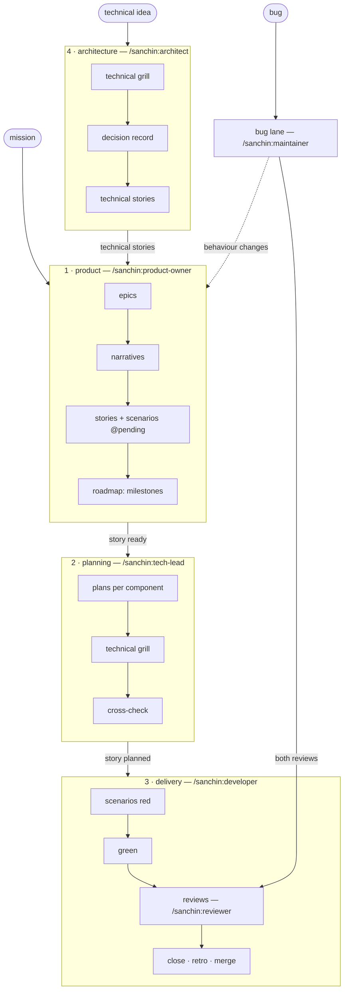

# The process

[README](../../README.md) · [Docs](../index.md)

How an idea becomes reviewed code on `main`: four cycles, each run by one
role. This directory is the single source of the process — every role
skill reads its own cycle here, and nothing else restates it. Read this
page first; then only what your task needs, from the table below.

Every rule carries its *why* — the general reason it exists — so it can be
applied to cases that don't look like the one that produced it. Words in
*italics* are roles the adapter maps to the project's own names (a *story*
may be `historia`; a *plan*, `tec spec`), and paths come from the adapter
([adapter.md](../adapter.md)); the process never names a project's
directory.

| Document | What it contains | When to read it |
|---|---|---|
| [states.md](states.md) | The five story states, what each requires, how a story goes back, and the retro every cycle ends with. | Every role, before taking or handing over a story. |
| [product.md](product.md) | The product cycle: epics, narratives, stories — short SMART increments — scenarios tagged `@pending`, the roadmap. | Product owner; anyone judging whether a story is ready. |
| [planning.md](planning.md) | The planning cycle: plans per component, technical grill, cross-check. | Tech-lead; a developer sending a story back. |
| [delivery.md](delivery.md) | The delivery cycle: start, scenarios red, green, reviews, close, merge. | Developer, reviewer. |
| [architecture.md](architecture.md) | The architecture cycle: technical grill, decision record, technical stories. | Architect; a tech-lead whose design doesn't fit the decisions in force. |
| [bug-lane.md](bug-lane.md) | The short lane for known bugs, and when it escalates. | Maintainer. |
| [working-rules.md](working-rules.md) | Pacing, costly runs, trunk-based git, approvals. | Every role, once per session. |

## Roles and cycles

Four cycles, each run by one role. A role finishes its cycle, leaves its
artifacts validated, and **stops**; the next role starts when the user
invokes it. *Why:* each hand-off is a decision the user owns — what to
build, how to build it, that it is done — and a role that ran on into the
next cycle would make it for them.

| Cycle | Role | Takes | Hands over |
|---|---|---|---|
| [1 · Product](product.md#1-product-cycle) | product owner | the mission, an idea, an escalated bug, technical stories | stories **ready**, placed in the roadmap |
| [2 · Planning](planning.md#2-planning-cycle) | tech-lead | a ready story | the story **planned**: closed plans, one per component |
| [3 · Delivery](delivery.md#3-delivery-cycle) | developer | a planned story | the story **implemented**, merged |
| [4 · Architecture](architecture.md#4-architecture-cycle) | architect | a technical idea: a refactor, a new tool, an architecture change | an accepted decision record and its technical stories |
| [Bug lane](bug-lane.md#bug-lane) | maintainer | a known bug | the issue resolved, merged — or a story for the product owner |

`/sanchin:reviewer` serves delivery and the bug lane; `/sanchin:coach`
reads every cycle's retros ([improvement.md](../improvement.md)).

